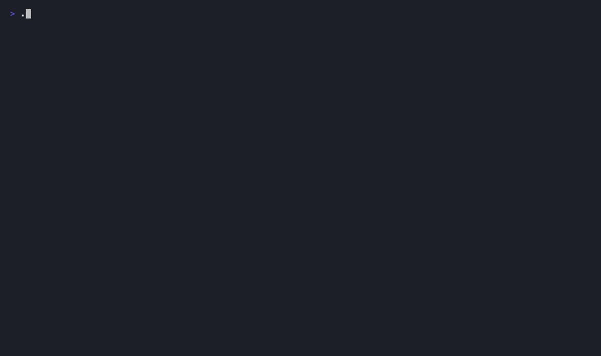
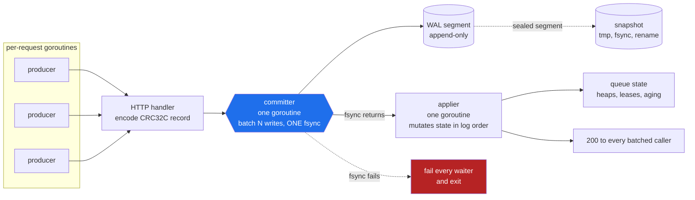
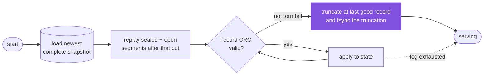

# franq ⚡

*A Frankenstein queue: FIFO, LIFO, priority, delay and anti-starvation aging stitched
onto one spine - an HTTP queue server with its own group-commit write-ahead log.
Go stdlib only. Zero dependencies. It's alive.*

```
$ go build ./cmd/franqd && ./franqd
franqd: it's alive ⚡ listening on [::]:1818, data in ./franq-data
```

(Port 1818: the year *Frankenstein* was published.)



Every scenario above asserts its own outcome and prints PASS, so the recording cannot
show a passing run of a broken build. Reproduce it with `vhs demo.tape`, or just run
`./bin/igor demo all`.

## What it is

An HTTP application that is a queue - where the behaviors compose instead of being
separate queue types:

| Capability | How |
|---|---|
| FIFO / LIFO | per-queue `order` config (the tie-break direction) |
| Priority | per-message `priority` 0–255, higher first |
| Delay | per-message `delay_ms`; invisible until it expires |
| Priority aging | per-queue `aging_rate` λ: +λ effective priority per second waited - starvation is impossible |
| Lease + ack | dequeue leases under a visibility timeout; ack deletes, nack/crash/timeout replays |
| Dead-letter queues | after `max_deliveries` attempts a message moves to `name.dlq` (a normal, inspectable queue) |
| Time-travel replay | `POST /v1/queues/{q}/replay` re-enqueues already-completed messages from WAL history |

So yes: a *delayed, priority, aging LIFO queue* is one `POST /v1/queues` away.

**Hard requirements, met:** data is persisted and durable across restarts (own WAL +
snapshots, fsync before any acknowledgement - proven by a `kill -9` crash matrix);
storage is not delegated to any queue or database (files and `fsync`, nothing else  - 
`go.mod` has zero requirements); fully concurrent (group commit is *faster* with
concurrent producers; long-poll consumers park on condition-style waiters).

## The write path

Everything durable hangs on one rule: nothing is externally observable before its
record is fsynced. The committer is where that rule is enforced.



The fsync is the boundary. Enqueue 200s, ack 200s and heap insertion all happen to
its right, which is why recovery can truncate a torn tail and know it is dropping
only operations nobody was ever told succeeded.

Batching is what makes that affordable: one fsync serves every producer waiting on
it, so durability gets **faster** under concurrency rather than slower.

## Recovery



Leases are deliberately absent from both diagrams: dequeue is memory-only, so a
crash makes in-flight messages visible again. That is the at-least-once contract,
and it is the same trade SQS makes.

## Quickstart

```bash
make build            # → bin/franqd, bin/igor
./bin/franqd &        # serve on :1818, data in ./franq-data

# a delayed-priority-LIFO queue with aging, all four behaviours on one queue
curl -s localhost:1818/v1/queues -d '{"name":"jobs","order":"lifo","aging_rate":2}'

curl -s localhost:1818/v1/queues/jobs/messages \
  -d '{"messages":[{"body":"hello","priority":5},{"body":"later","delay_ms":3000}]}'

curl -s localhost:1818/v1/queues/jobs/dequeue -d '{"wait_ms":5000}'
# → {"messages":[{"id":"1","body":"hello","token":"…"}]}

curl -s localhost:1818/v1/queues/jobs/ack -d '{"acks":[{"id":"1","token":"…"}]}'
```

### igor, the lab assistant

```bash
./bin/igor demo all        # five scripted, self-checking scenarios
./bin/igor create -q work -aging 1 -max-deliveries 3
./bin/igor send   -q work -body "resize image" -n 20
./bin/igor work   -q work -n 4 -fail-rate 0.15   # 4 workers, 15% simulated failures
./bin/igor stats
```

`igor demo all` shows: a VIP jumping a backlog, delayed visibility, a worker dying
mid-lease and the job replaying elsewhere, a low-priority job starving without aging
and climbing out with it, and replaying acked history.

## API

| Endpoint | Purpose |
|---|---|
| `POST /v1/queues` | create - `{name, order, aging_rate, max_deliveries, default_lease_ms}` |
| `GET /v1/queues` · `GET /v1/queues/{q}` | list / stats |
| `DELETE /v1/queues/{q}` | delete (and its DLQ) |
| `POST /v1/queues/{q}/messages` | batch enqueue - `{messages:[{body, priority?, delay_ms?}]}` |
| `POST /v1/queues/{q}/dequeue` | `{max?, wait_ms?, lease_ms?}` - long-polls; returns messages + lease tokens |
| `POST /v1/queues/{q}/ack` | `{acks:[{id, token}]}` - stale token ⇒ 409 `lease_lost` |
| `POST /v1/queues/{q}/nack` | `{id, token, delay_ms?}` - return early with optional backoff |
| `POST /v1/queues/{q}/extend` | lease heartbeat for long jobs |
| `POST /v1/queues/{q}/replay` | `{from?, to?, limit?}` (RFC3339) - time travel |
| `GET /healthz` | liveness |

Message ids are decimal strings (uint64 would overflow JS numbers). Bodies are JSON
strings - text payloads; base64 binary yourself. Delays are relative (`delay_ms`), so
client clocks are never trusted.

## Design

### No modes - only sort keys

There is no FIFO code path, no LIFO code path, no priority branch. Every message
carries `(priority, seq, visible_at)`; every ready message sits in **one heap under one
comparator**: effective priority first, then arrival order in the configured direction.
Set every priority to 0 and you have pure FIFO/LIFO. Set λ and priorities and you have
an aging priority queue. Every advertised combination is the same code.

### Aging that costs nothing

Linear aging says effective priority at time *t* is `p + λ(t − start)`. Compare two
messages and *t* cancels:

```
p₁ + λ(t−s₁) > p₂ + λ(t−s₂)   ⇔   p₁ − λ·s₁ > p₂ − λ·s₂
```

So the heap key `p − λ·start` is **static**: exact continuous aging with zero
re-heapification, no sweeps, no timers. `start` is the *visibility* time, so a delayed
message doesn't arrive pre-aged. One honest consequence, on purpose: with λ > 0,
equal-priority messages drain oldest-first even on a LIFO queue - LIFO starves old
messages by design and aging exists to prevent exactly that, so when both are
configured, aging wins. `igor demo starvation` shows it rather than hiding it.

### The storage engine (the part that isn't delegated)

```
HTTP handler → encode record → committer (batch + ONE fsync) → applier → respond
```

* **Group-commit WAL.** Append-only segments of CRC32C-framed records
  (`ENQUEUE / ACK / REQUEUE / QCREATE / QDELETE`). A single committer goroutine
  batches every concurrent producer into one write + one fsync. Measured on an
  M3 Pro (128-byte bodies):

  | mode | latency/op | throughput |
  |---|---|---|
  | fsync per record (1 producer) | 2.76 ms | ~360 records/s |
  | group commit (64 producers) | 13.8 µs | ~72,000 records/s |

  **200× - durability that gets *faster* under concurrency.**

* **The one invariant everything hangs on:** *nothing is externally observable before
  its record is fsynced.* Enqueue 200s, ack 200s and heap insertion all happen after
  commit. So when recovery finds a torn tail and truncates it, it is provably dropping
  only operations nobody was ever told succeeded.

* **A single applier goroutine** mutates queue state in exact log order. That one
  choice makes snapshot cuts trivially consistent (captured precisely at a sealed
  segment boundary), and means the log never needs conflict resolution.

* **Snapshots + retention.** Sealed segments trigger a background snapshot
  (tmp → fsync → rename; the old snapshot survives until the new one is durable).
  Snapshot ≠ retention: `-retain-bytes` keeps sealed segments after they're
  compacted-from, because retained history **is** the replay window - Kafka's
  insight, applied to a queue. `nextMsgID` lives in the snapshot header so ids are
  never reused even when their records are gone.

* **fsync failure = poison.** After a failed fsync the page cache is unknowable;
  retrying would silently lie about durability. franq fails every waiter, exits, and
  lets recovery re-read the truth from disk.

* **Leases are deliberately NOT persisted.** Dequeue is memory-only - the hot path
  pays zero fsyncs. A crash makes in-flight messages visible again: that's the
  at-least-once contract, the same trade SQS makes. The ack/nack/expiry race is
  serialized by lease-entry removal under the queue mutex *before* logging, so the
  log never contains conflicting records for one delivery.

### Concurrency

Go's HTTP server gives a goroutine per request; the long-poll *waiter is the handler
itself* - nothing spawned, nothing leaked, no lost wakeups (registration shares the
mutex with insertion+notify), one wakeup per newly-ready message (no thundering herd).
Group commit turns producer concurrency into throughput. The whole suite runs under
`-race`.

## Proof

```bash
make test        # unit + property + e2e (ordering vs a reference model, torn tails at
                 # every byte offset, restart durability, lease races, DLQ, replay)
make race        # everything again under the race detector
make bench       # the group-commit numbers above
make crashtest   # the flagship
```

`make crashtest` builds the real binary and **SIGKILLs it mid-traffic eight times**
(4 producers + 4 consumers, random priorities/delays/nacks), then restarts, drains and
asserts: every acknowledged enqueue is delivered (nothing lost), no acknowledged ack is
ever seen again (no zombies), duplicates only where at-least-once permits them, every
recovery healthy. It also uses failpoints (`FRANQ_FAILPOINT=mid-snapshot:1`) to die at
surgically chosen points inside the storage engine. A typical run:

```
crash matrix: 2851 confirmed enqueues, 2868 confirmed acks,
              67 maybe-enq, 54 maybe-ack, 113 nacks - no loss, no zombies
```

---

## Design questions, answered

### How do you handle replay?

Three layers, all implemented:

1. **Redelivery (involuntary replay).** Dequeue is a lease, not a removal. Ack
   deletes; nack, lease expiry or a worker crash puts the message back with its
   delivery count incremented (persisted via `REQUEUE` records, so counts survive
   restarts). Stale tokens are rejected - a dead worker can't ack a job that was
   already redelivered elsewhere. Server crashes revive all in-flight leases:
   at-least-once, honestly stated.
2. **Dead-letter queues (replay circuit-breaker).** After `max_deliveries` attempts,
   the message moves to `name.dlq` - logged as ENQUEUE-into-dlq *then* ACK-of-original
   (add before remove: a crash between the two yields a duplicate, never a loss). The
   DLQ is a normal queue: inspect it, drain it, replay it.
3. **Time travel (voluntary replay).** The WAL is an event log, and retention is
   decoupled from compaction - so `POST /replay {from, to}` re-enqueues copies of
   *already-acked* messages from history, with `origin_id` linking each copy to its
   source. Reprocess yesterday's orders after a bug fix. SQS, RabbitMQ: can't.

### How would you refactor into Pub/Sub?

The storage engine already is one: an ordered, retained log with consumers positioned
on it. A queue is the special case of *one* cursor whose acks delete. The refactor:

1. **Subscriptions as named cursors.** `POST /v1/queues/{q}/subscriptions {name}`  - 
   each holds `(ack'd-through position, pending set)`. Today's queue becomes the
   implicit single subscription.
2. **Acks move cursors instead of deleting.** `ACK(sub, id)` records per-subscription
   progress; messages stop being deleted on ack at all.
3. **Retention becomes the deletion policy.** Already true here (`-retain-bytes`);
   segments compact when every subscription has passed them.
4. **Per-subscription delivery state.** The lease table and DLQ become per-subscription
   (consumer groups fall out free: N workers sharing one subscription already works  - 
   that's just today's queue).
5. **Fan-out.** ENQUEUE applies to every subscription's view; the delay/priority/aging
   machinery stays per-subscription, which yields something Pulsar doesn't offer:
   per-subscriber ordering *policies* over the same stream.

The WAL format doesn't change; ENQUEUE records are already immutable history. The
refactor is state-tracking above the log, not a new engine.

### With more time?

Replication (the applier's strict log order makes it Raft-shaped already: replicate
the batch stream, snapshots are ready-made install points). Producer idempotency keys
+ a dedup window for exactly-once enqueue. Cron/recurring messages (the delay heap
generalizes). Message TTLs. Prometheus metrics + OTel tracing. Auth + multi-tenancy.
Backpressure quotas. A `peek` API. Compression for large bodies. Each is deliberately
absent now - small core, every line tested - but none requires re-architecting.

### Why franq over SQS / RabbitMQ / Pulsar?

**The composition doesn't exist elsewhere.** SQS FIFO: no priority, no LIFO, delay
capped at 15 minutes, no replay of acked messages. RabbitMQ: priority queues, but a
starved message stays starved - nothing ages; x-delayed-message is a plugin with known
loss caveats. Pulsar: replay yes, but priority no, and it's a cluster (brokers +
BookKeeper + ZooKeeper) you operate. franq gives you *delayed aging priority LIFO with
time travel* in one flag-configured queue.

**Operational weight.** One static binary, one data directory, zero dependencies.
`scp` it to a box and you have a durable queue in the time SQS takes to load its
console. Local-first: dev laptops, CI, edge nodes, air-gapped environments - places
where an AWS dependency or a three-service cluster is disqualifying.

**Honest durability, measured.** fsync-before-acknowledge with group commit
(72k records/s durable on a laptop), a crash matrix that kill -9s the real binary, and
a README that tells you exactly which trade-offs were made (at-least-once, leases not
persisted, fsync failure = crash).

**When NOT to use franq** - honesty is a feature: it's single-node (no replication  - 
your durability floor is the disk), single-process, and unauthenticated. If you need
five-nines multi-AZ or cross-region fan-out, use SQS/Pulsar and pay their complexity
tax. franq's niche is the enormous space below that.

## Layout

```
cmd/franqd          server binary        cmd/igor            client CLI + demos
internal/wal        records, segments, group commit, snapshots, recovery, failpoints
internal/core       keys, heaps, queues, leases, broker/applier, time-travel replay
internal/server     HTTP handlers        internal/client     Go client (CLI + tests)
test/               e2e + torn-tail      test/crash          the kill -9 matrix
```
